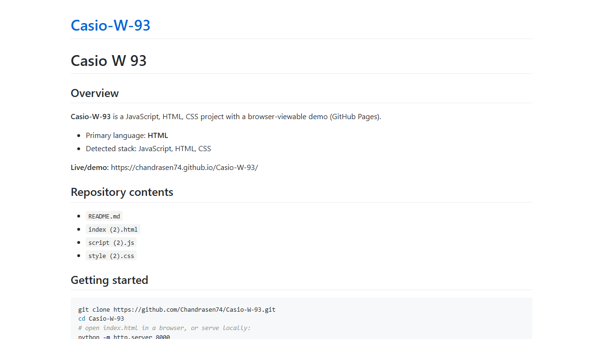

# Casio-W-93

**Live demo:** https://chandrasen74.github.io/Casio-W-93/  
**Repository:** https://github.com/Chandrasen74/Casio-W-93



## Overview
`Casio-W-93` is a HTML/CSS/JavaScript project.
- **Primary language:** HTML
- **Languages detected:** HTML, JavaScript, CSS
- **Stack/tech:** HTML, CSS, JavaScript

## Language & stack details
- Languages: HTML, JavaScript, CSS
- Frameworks/tools/libraries: HTML, CSS, JavaScript

## How to install & run
### Prerequisites
- A modern web browser
- (Optional) [Python 3](https://www.python.org/) or any static file server for local serving

### Run locally
```bash
git clone https://github.com/Chandrasen74/Casio-W-93.git
cd Casio-W-93
```
- **Option 1:** open `index.html` directly in your browser
- **Option 2:** serve locally (recommended for some JS features):
```bash
python -m http.server 8000
# then open http://localhost:8000
```

## Repository structure (top-level/sample)
- `README.md`
- `index (2).html`
- `screenshot.png`
- `script (2).js`
- `style (2).css`

## Status
Documented with screenshot, language/stack details, and setup instructions as part of a profile-wide README update.
